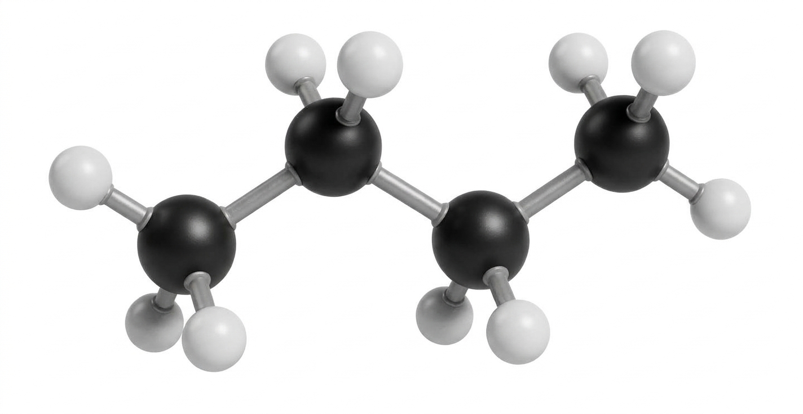
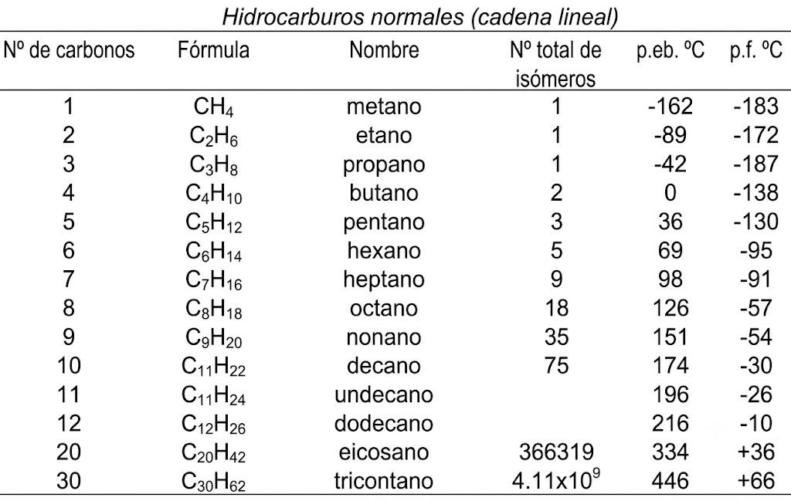
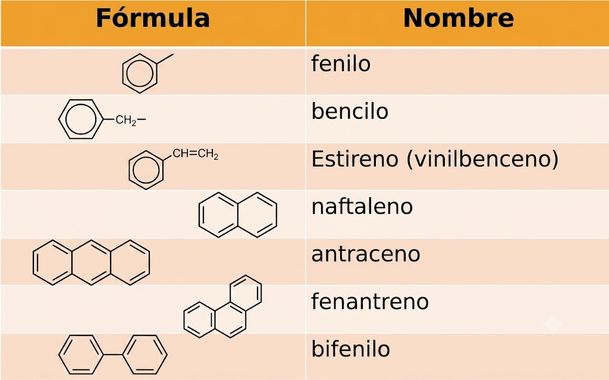
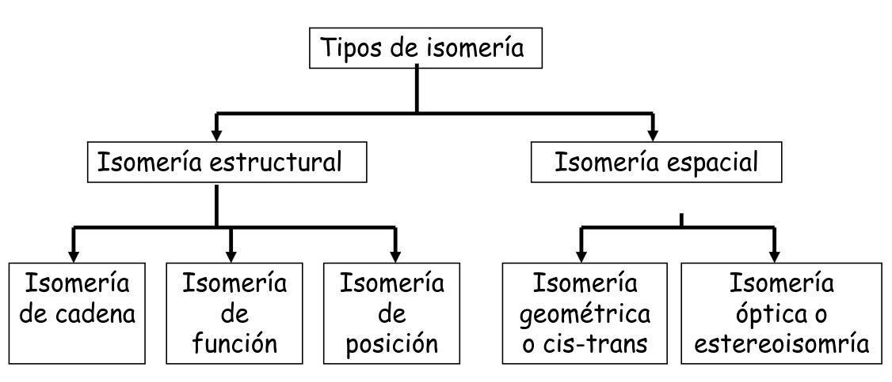
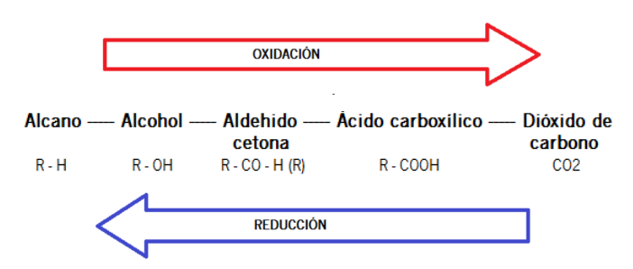
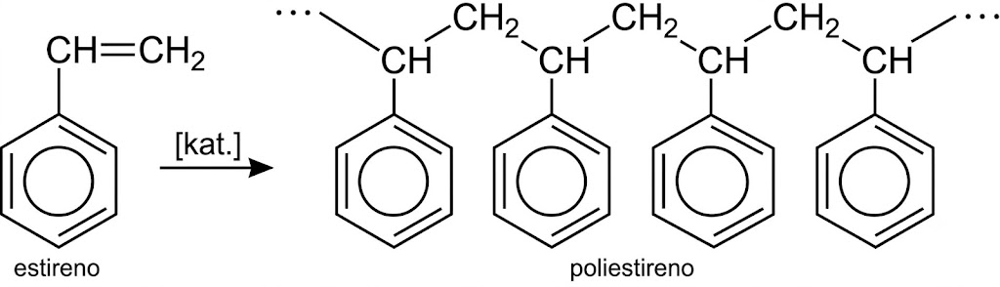
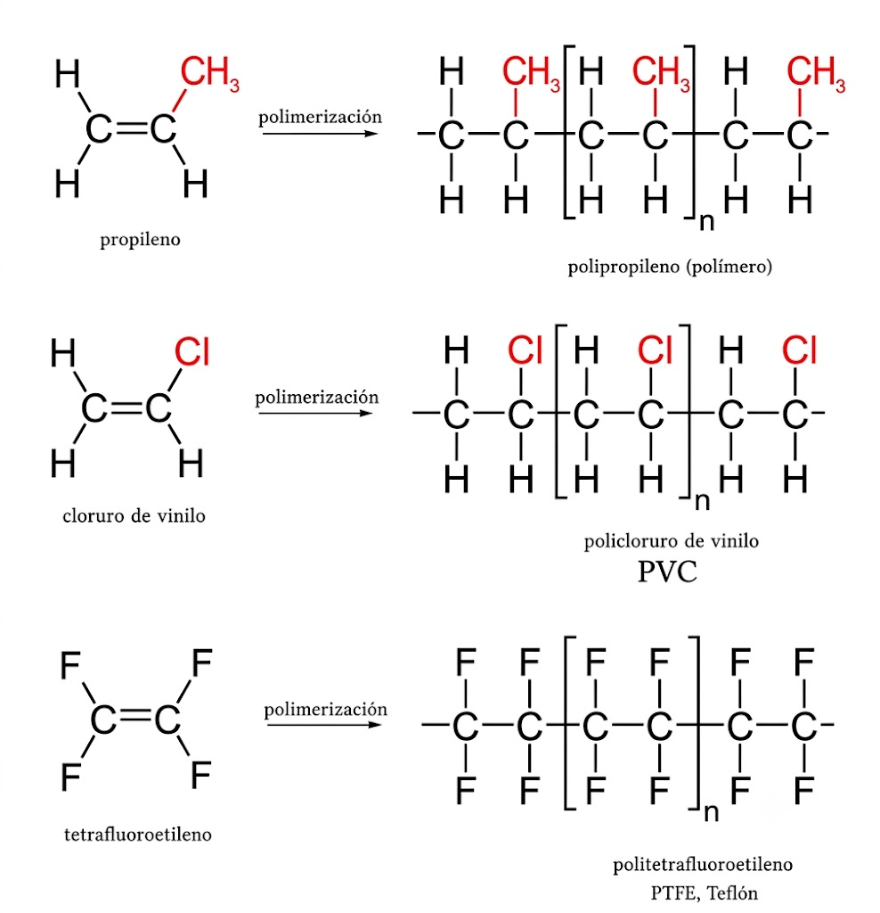
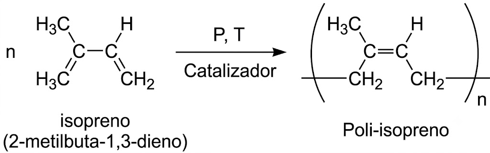

# Tema 3. Química Orgánica

## **1. Introducción**

El “vitalismo” consideraba que los compuestos orgánicos –componentes de los seres vivos– no podían sintetizarse en el laboratorio.

Desde que Wöhler sintetizó urea (1828) a partir de compuestos inorgánicos sabemos que no es así.

Puesto que en prácticamente todos los compuestos orgánicos aparece el carbono, a esta rama de la química se la llama **química del carbono**.

El número de compuestos de carbono conocido es enorme, más de 10 millones, mientras que de inorgánicos apenas se conocen unos cien mil.

## **2. Enlaces del carbono**

Las cadenas de carbono tienen una disposición en zigzag debido a la orientación tetraédrica de los orbitales $\ce{sp^3}$ responsables con sus solapamientos de los enlaces sigma. Esta estructura de zigzag se interrumpe con los enlaces dobles o triples. A su vez, la posibilidad de ramificaciones o ciclos hace que el número de posibilidades para formar moléculas sea enorme.

| Orbitales | Ángulo interatómico | Geometría molecular | Tipo de enlace | Ejemplos |
| :--- | :--- | :--- | :--- | :--- |
| 4 orbitales $\text{sp}^3$ | $109{,}3^\circ$ | tetraédrica | sencillo | $\text{C-H}$, $\text{C-C}$ |
| 3 orbitales $\text{sp}^2$ 1 orbital $\text{p}$ | $120^\circ$ | trigonal plana | doble | $\text{C=C}$, $\text{C=O}$ |
| 2 orbitales $\text{sp}$ 2 orbitales $\text{p}$ | $180^\circ$ | lineal | triple dos dobles | $\text{C}\equiv\text{C}$, $\text{C}\equiv\text{N}$ $\text{C=C=C}$, $\text{C=C=O}$ |

### **Representación de las moléculas orgánicas** {: .caja-subtitulo}

La representación de las moléculas orgánicas transmite desde la composición elemental hasta la disposición tridimensional de los átomos mediante fórmulas estructurales, diagramas bidimensionales y proyecciones estereoquímicas.

<!--
##latex id=empirica_butano sep=2em
\schemestart
	\subscheme{
        \chemfig{[0,1.2] C_2H_5} 
    }
\schemestop
-->

<!--
##latex id=molecular_butano sep=2em
\schemestart
	\subscheme{
        \chemfig{[0,1.2] C_4H_{10}} 
    }
\schemestop
-->

<!--
##latex id=desarrollada_butano sep=2em
\schemestart
	\subscheme{
        \chemfig{[0,1.2] H-C(-[6]H)(-[2]H)-C(-[6]H)(-[2]H)-C(-[6]H)(-[2]H)-C(-[6]H)(-[2]H)-H} 
    }
\schemestop
-->

<!--
##latex id=semidesarrollada_butano sep=2em
\schemestart
	\subscheme{
        \chemfig{[0,1.2] CH_3-CH_2-CH_2-CH_3} 
    }
\schemestop
-->

<!--
##latex id=condensada_butano sep=2em
\schemestart
	\subscheme{
        \chemfig{[0,1.2] CH_3-{(}CH_2{)}_2-CH_3} 
    }
\schemestop
-->

<!--
##latex id=espacial_butano sep=2em
\schemestart
	\subscheme{

\setchemfig{
  cram width = 3.5pt,       % Ancho de la base de la cuña (por defecto es ~1.5pt)
  cram dash length = 1.2pt, % Longitud de cada trazo en la cuña de rayas
  cram dash sep = 1.5pt     % Separación entre trazos
}

\chemfig{
  H_3C
  -[:30]C(>[:100]H)(>:[:40]H)
  -[:-30]C(>[:-100]H)(>:[:-40]H)
  -[:30]CH_3
}
    }
\schemestop
-->

<!--
##latex id=lineal_butano sep=2em
\schemestart
	\subscheme{
        \chemfig{[0,1.2] -[:30]-[:-30]-[:30] } 
    }
\schemestop
-->

|Tipo de fórmula | Descripción | Ejemplo (Butano) |
|--|--|--|
| **Empírica** | Indica la proporción mínima de números enteros entre los átomos. | {style="display: block; margin: 0 auto; width: 50%; height: auto;"} |
| **Molecular** | Muestra la cantidad real de átomos de cada elemento en la molécula. | {style="display: block; margin: 0 auto; width: 50%; height: auto;"} | 
| **Desarrollada** | Muestra explícitamente todos los átomos y cada uno de sus enlaces en un plano. | {style="display: block; margin: 0 auto; width: 100%; height: auto;"}  |
| **Semidesarrollada** | Omite los enlaces $\text{C-H}$, agrupando los átomos de hidrógeno con su carbono correspondiente. | {style="display: block; margin: 0 auto; width: 150%; height: auto;"} | 
| **Condensada** | Los grupos que se repiten se agrupa entre paréntesis. | {style="display: block; margin: 0 auto; width: 150%; height: auto;"} | 
| **Esquelética** (Lineal / Zig-zag) | Representa la cadena de carbonos mediante líneas continuas; cada extremo y vértice es un $\text{C}$. Los $\text{H}$ unidos a carbono se omiten implícitamente.| {style="display: block; margin: 0 auto; width: 100%; height: auto;"}  |
| **Espacial** | Representación tridimensional | { style="display: block; margin: 0 auto; width: 90%; height: auto;" } |
| **Modelo de varillas** | Representación tridimensional en la que los enlaces covalentes se representan mediante varillas o cilindros rígidos, y los núcleos atómicos mediante esferas de tamaño reducido | { style="display: block; margin: 0 auto; width: 90%; height: auto;" } |

### **Grupos funcionales** {: .caja-subtitulo}

Un **grupo funcional** es un átomo o grupo de átomos que dan al compuesto sus propiedades características. Se podría decir que es cualquier cosa que no sean enlaces simples C-C o C-H.

| Clase de Compuesto | Grupo Funcional, Nombre | Fórmula General | Prefijo | Sufijo | Ejemplo |
| :--- | :--- | :--- | :--- | :--- | :--- |
| **Alcoholes** | $-\ce{OH}$, hidróxido | $\ce{R-OH}$ | hidroxi– | –ol | $\ce{CH3-OH}$, metanol |
| **Aldehídos** | $-\ce{CHO}$, carbonilo | $\ce{R-CHO}$ | oxo– (formil) | –al | $\ce{HCHO}$, metanal (formaldehído) |
| **Aminas** | $-\ce{NH2}$, amino | $\ce{R-NH2}$ | amino– | –amina | $\ce{CH3-NH2}$, metilamina |
| **Ácidos carboxílicos** | $-\ce{COOH}$, carboxilo | $\ce{R-COOH}$ | —— | ácido –oico | $\ce{CH3-COOH}$, ácido etanoico (ácido acético) |
| **Ésteres** | $-\ce{COO}-$ | $\ce{R-COO-R}'$ | —— | –ato de alquilo | $\ce{CH3-COO-CH3}$, acetato de metilo |
| **Éteres** | $-\ce{O}-$ | $\text{R-O-R}'$ | alcoxi– | alquil-éter | $\ce{CH3-O-CH3}$, dimetiléter (metoximetano) |
| **Halogenuros de alquilo** | $-\text{X}$ ($\text{X} =$ flúor, cloro, bromo, yodo) | $\text{R}-\text{X}$ | fluoro–, cloro–, bromo–, yodo– | —— | $\ce{CH3-Cl}$, clorometano (cloruro de metilo) |
| **Cetonas** | $>\ce{C = O}$, carbonilo | $\ce{R-CO-R}'$ | oxo– | –ona | $\ce{CH3-CO-CH3}$, propanona (acetona) |
| **Nitrilos** | $-\ce{C \equiv N}$, nitrilo, cianuro | $\ce{R-CN}$ | ciano– | –nitrilo | $\ce{CH3-CN}$, acetonitrilo (cianometano; cianuro de metilo) |

###  **Series homólogas** {: .caja-subtitulo}

Una **serie homóloga** es el conjunto de compuestos orgánicos que tienen el mismo grupo funcional y cuya cadena carbonada se ve incrementada con grupos intermedios $\ce{-CH2-}$.

Podemos ver la serie homóloga de los hidrocarburos lineales y cómo varían las propiedades físicas que dependen de la masa molecular.

{ style="display: block; margin: 0 auto; width: 70%; height: auto;" }

### **Propiedades físicas de los compuestos orgánicos** {: .caja-subtitulo}

Son en general las que presentan los compuestos con enlaces covalentes, es decir, dependen básicamente de la masa molecular y de la polaridad de los grupos funcionales, ya que cuanto mayores sean ambas mayores serán las fuerzas intermoleculares.

Las sustancias que puedan formar enlaces de hidrógeno (alcoholes, ácidos, aminas…) podrán ser líquidas o sólidas a temperatura ambiente aunque no tengan grandes masas moleculares. En el caso de que no posean enlaces de hidrógeno, pero sean polares, también tendrán puntos de fusión y ebullición mayores que otras apolares de similar masa molecular.

En cuanto a las sustancias apolares, su estado físico dependerá básicamente de su masa molecular (como se observa en la serie de los alcanos), asociadas a las fuerzas de Van der Waals.

En cuanto a la solubilidad dependerá de la polaridad de las moléculas. La mayoría son apolares o muy poco polares (hidrocarburos, éteres, cetonas…), así que no se disolverán en agua pero sí en disolventes apolares (benceno, acetona...).

Los de mayor carácter polar como ácidos, alcoholes, aminas primarias o amidas serán solubles en agua, pero hay que tener en cuenta que la solubilidad disminuye a medida que crece la longitud de la cadena carbonada, ya que esta es apolar. Por ejemplo, el etanol es totalmente soluble en agua, pero el pentanol tiene una solubilidad de solo 2,7 g de alcohol por cada 100 g de agua.

## **3. Formulación y nomenclatura orgánica**

El texto de formulación y nomenclatura orgánica está tomado de la página AlonsoFormula (http://www.alonsoformula.com/organica/). En dicha página se pueden encontrar numerosos ejemplos de cómo proceder para nombrar cuando dan una fórmula y para formular cuando nos dan un nombre. También tiene numerosos ejercicios en los que se puede comprobar si se han hecho bien.

### **Alcanos** {: .caja-subtitulo}

Son compuestos de C e H (de ahí el nombre de hidrocarburos) de cadena abierta que están unidos entre sí por enlaces sencillos (C-C y C-H).

* Su fórmula empírica es $\ce{C_nH_{2n+2}}$, siendo $n$ el número de carbonos.
* Los cuatro primeros tienen un nombre sistemático que consiste en los prefijos **met-**, **et-**, **prop-**, y **but-** seguidos del sufijo **"-ano"**. Los demás se nombran mediante los prefijos griegos que indican el número de átomos de carbono y la terminación **"-ano"**.
* Se llama **radical alquilo** a las agrupaciones de átomos procedentes de la eliminación de un átomo de H en un alcano, por lo que contiene un electrón de valencia disponible para formar un enlace covalente. Se nombran cambiando la terminación **-ano** por **-ilo**, o **-il** cuando forme parte de un hidrocarburo.
* Cuando aparecen ramificaciones (cadenas laterales) hay que seguir una serie de normas para su correcta nomenclatura.

### **Reglas de nomenclatura para alcanos ramificados** {: .caja-subtitulo}

1. Se **elige la cadena más larga**. Si hay dos o más cadenas con igual número de carbonos se escoge la que tenga mayor número de ramificaciones.
2. Se **numeran los átomos de carbono** de la cadena principal comenzando por el extremo que tenga más cerca alguna ramificación, buscando que la posible serie de números **"localizadores"** sea siempre la menor posible.
3. Las **cadenas laterales se nombran antes** que la cadena principal, precedidas de su correspondiente número localizador y con la terminación **"-il"** para indicar que son radicales.
4. Si un mismo átomo de carbono tiene dos radicales se pone el número localizador delante de cada radical y se ordenan por **orden alfabético**.
5. Si un mismo radical se repite en varios carbonos, se separan los números localizadores de cada radical por comas y se antepone al radical el prefijo **"di-"**, **"tri-"**, **"tetra-"**, etc.
6. Si **hay dos o más radicales diferentes** en distintos carbonos, **se nombran por orden alfabético** anteponiendo su número localizador a cada radical. En el orden alfabético no se tienen en cuenta los prefijos multiplicativos (di-, tri-, tetra-, etc.) así como *sec-*, *terc-*, y otros como *cis-*, *trans-*, *o-*, *m-*, y *p-*; pero cuidado, **sí se tiene en cuenta** el prefijo **iso-**.
7. Si las cadenas laterales son complejas, se nombran de forma independiente y se colocan encerradas dentro de un paréntesis como los demás radicales por orden alfabético. En estos casos se ordenan por la primera letra del radical. Por ejemplo, en el *(1,2-dimetilpropil)* sí tendremos en cuenta la "d" para el orden alfabético, por ser un radical complejo. En las cadenas laterales el localizador que lleva el número 1 es el carbono que está unido a la cadena principal.

### **Alquenos** {: .caja-subtitulo}

Son hidrocarburos de cadena abierta que se caracterizan por tener uno o más dobles enlaces, $\ce{C=C}$.

Se nombran igual que los alcanos, pero con la terminación en **"-eno"**. De todas formas, hay que seguir las siguientes reglas:

* **Se escoge como cadena principal la más larga que contenga el doble enlace**. De haber ramificaciones se toma como cadena principal la que contenga el mayor número de dobles enlaces, aunque sea más corta que las otras.
* Se **comienza a contar por el extremo más cercano a un doble enlace**, con lo que el doble enlace tiene preferencia sobre las cadenas laterales a la hora de nombrar los carbonos, y se nombra el hidrocarburo especificando el primer carbono que contiene ese doble enlace.
* La IUPAC recomienda la colocación del número localizador inmediatamente antes del sufijo (ej. but-2-eno). En el caso de que hubiera más de un doble enlace se emplean las terminaciones **"-dieno"**, **"-trieno"**, etc., precedidas por los números que indican la posición de esos dobles enlaces.

### **Alquinos** {: .caja-subtitulo}

Son hidrocarburos de cadena abierta que se caracterizan por tener uno o más triples enlaces, carbono-carbono.

En general su nomenclatura sigue las pautas indicadas para los alquenos, pero terminando en **"-ino"**.

Es interesante la nomenclatura de los hidrocarburos que contienen dobles y triples enlaces en su molécula. En este caso, hay que indicar tanto los dobles enlaces como los triples, pero con preferencia por los dobles enlaces que serán los que dan nombre al hidrocarburo.

Llamaremos a estos compuestos **eninos**, nombraremos antes los dobles enlaces y luego los triples. La cadena principal es la que tenga mayor número de insaturaciones.

### **Hidrocarburos cíclicos** {: .caja-subtitulo}

Son hidrocarburos de cadena cerrada. Los ciclos también pueden presentar insaturaciones.

Los hidrocarburos cíclicos se nombran igual que los hidrocarburos (alcanos, alquenos o alquinos) del mismo número de átomos de carbono, pero anteponiendo el prefijo **"ciclo-"**.

* Si el ciclo tiene varios sustituyentes se numeran de forma que reciban los localizadores más bajos, y se ordenan por orden alfabético. En caso de que haya varias opciones decidirá el orden de preferencia alfabético de los radicales.
* En el caso de anillos con insaturaciones, los carbonos se numeran de modo que dichos enlaces tengan los números localizadores más bajos.
* Si el compuesto cíclico tiene cadenas laterales más o menos extensas, conviene nombrarlo como derivado de una cadena lateral. En estos casos, los hidrocarburos cíclicos se nombran como radicales con las terminaciones **"-il"**, **"-enil"**, o **"-inil"**.

### **Hidrocarburos aromáticos** {: .caja-subtitulo}

Son hidrocarburos derivados del benceno ($\ce{C6H6}$). El benceno se caracteriza por una inusual estabilidad, que le viene dada por la particular disposición de los dobles enlaces conjugados.

El nombre genérico de los hidrocarburos aromáticos mono y policíclicos es **"areno"** y los radicales derivados de ellos se llaman radicales **"arilo"**. Todos ellos se pueden considerar derivados del benceno, que es una molécula cíclica, de forma hexagonal y con un orden de enlace intermedio entre un enlace sencillo y un doble enlace donde todos sus enlaces son equivalentes por resonancia.

Experimentalmente se comprueba que los seis enlaces son equivalentes, de ahí que la molécula de benceno se represente como una estructura resonante entre las dos fórmulas propuestas por Kekulé.

<!--
##latex id=benceno sep=2em
\schemestart
	\subscheme{
        \chemfig{[0,1.2]*6(=-=-=-)} 
		\arrow{<->}[0,1.2]
		\chemfig{[0,1.2]*6(-=-=-=)} 
		\arrow{<->}[0,1.2]
		\chemfig{[0,1.2]**6(------)}
    }
\schemestop
-->

{style="display: block; margin: 0 auto; width: 50%; height: auto;"}

Cuando el benceno lleva un radical se nombra primero dicho radical seguido de la palabra **"-benceno"**.

Si son dos los radicales se indica su posición relativa dentro del anillo bencénico mediante los números 1,2; 1,3 ó 1,4, teniendo el número 1 el sustituyente más importante. Sin embargo, en estos casos se sigue utilizando los prefijos **"orto-"** (1,2), **"meta-"** (1,3) y **"para-"** (1,4) para indicar esas mismas posiciones del segundo sustituyente.

En el caso de haber más de dos sustituyentes, se numeran de forma que reciban los localizadores más bajos, y se ordenan por orden alfabético. En caso de que haya varias opciones decidirá el orden de preferencia alfabético de los radicales.

Cuando el benceno actúa como radical de otra cadena se utiliza con el nombre de **"fenilo"**.

**Estructura de Ejemplo (Cadena con radicales fenilo)**:

<!--
##latex id=difenilo sep=2em
\schemestart
	\subscheme{
		\chemfig{[:-30]*6(=-=(-CH_2-CH([:-270]-CH_3)-CH_2-CH([:-270]-CH_2-[:0]CH_3)-CH_2-CH_2-(*6(=-=-=-)))-=-)}
	}
\schemestop
-->

{style="display: block; margin: 0 auto; width: 60%; height: auto;"}

{ style="display: block; margin: 0 auto; width: 60%; height: auto;" }

### **Halogenuros de alquilo** {: .caja-subtitulo}

Son hidrocarburos que contienen átomos de halógeno en su molécula: **R-X**, **Ar-X**.

Aunque no son hidrocarburos propiamente dichos, al no estar formados únicamente por hidrógeno y carbono, se consideran derivados de estos en lo referente a su nomenclatura y formulación.

Se nombran citando en primer lugar el halógeno seguido del nombre del hidrocarburo, indicando, si es necesario, la posición que ocupa el halógeno en la cadena, a sabiendas de que los dobles y triples enlaces tienen prioridad sobre el halógeno en la asignación de los números.

Si aparece el mismo halógeno repetido, se utilizan los prefijos **di-**, **tri-**, **tetra-**.

### **Alcoholes** {: .caja-subtitulo}

Su estructura es similar a la de los hidrocarburos, en los que se sustituye uno o más átomos de hidrógeno por grupos **"hidroxilo"**, **-OH**.

Se nombran como los hidrocarburos de los que proceden, pero con la terminación **"-ol"**, e indicando con un número localizador, el más bajo posible, la posición del grupo alcohólico. Según la posición del carbono que sustenta el grupo -OH, los alcoholes se denominan **primarios**, **secundarios** o **terciarios**.

<!--
##latex id=tipos_alcohol sep=2em
\schemestart
	\subscheme{
\chemnameinit{\chemfig{CH_3-CH_2-C(-[2]CH_3)(-[6]OH)-CH_3}}
\chemname{\chemfig{CH_3-CH_2-CH_2-OH}}{alcohol primario}
\hspace{2cm}
\chemname{\chemfig{CH_3-CH_2-CH(-[6]OH)-CH_3}}{alcohol secundario}
\hspace{2cm}
\chemname{\chemfig{CH_3-CH_2-C(-[2]CH_3)(-[6]OH)-CH_3}}{alcohol terciario}
	}
\schemestop
-->

{style="display: block; margin: 0 auto; width: 85%; height: auto;"}

Si en la molécula hay más de un grupo -OH se utiliza la terminación **"-diol"**, **"-triol"**, etc., indicando con números las posiciones donde se encuentran esos grupos. Hay importantes polialcoholes como la glicerina (*propanotriol*), la glucosa y otros hidratos de carbono.

Cuando el alcohol no es la función principal, se nombra como **"hidroxi-"**, indicando el número localizador correspondiente.

Ejemplo: &nbsp;&nbsp; **4-metil-3-hidroxipentanal**
  
<!--
##latex id=hidroxipentanal sep=2em
	\chemfig{CH_3-CH(-[2]CH_3)-CH(-[6]OH)-CH_2-CHO}
-->

{style="display: block; margin: 0 auto; width: 25%; height: auto;"}

### **Fenoles** {: .caja-subtitulo}

Son derivados aromáticos que presentan grupos hidroxilo, **-OH** unidos directamente a un anillo bencénico. Los fenoles tienen cierto carácter ácido y forman sales metálicas.

Se encuentran ampliamente distribuidos en productos naturales, como los taninos.

Se nombran como los alcoholes, con la terminación **"-ol"** añadida al nombre del hidrocarburo, cuando el grupo OH es la función principal.

<!--
##latex id=fenol sep=2em
\schemestart
	\subscheme{
        \chemfig{[0,1.2]*6(=-=-(-[2]OH)=-)} 
    }
\schemestop
-->

{style="display: block; margin: 0 auto; width: 8%; height: auto;"}

### **Éteres** {: .caja-subtitulo}

Son compuestos en los que un átomo de oxígeno está unido a dos radicales alquilo o arilo: **R-O-R'**.

Se pueden nombrar de dos formas distintas:

* Indicando los dos radicales por orden alfabético seguidos de la palabra **"éter"**.
  
* Nombrando el radical más sencillo con la terminación **"-oxi"** seguido del nombre del hidrocarburo del que deriva el radical más complejo.

Ejemplos:

* **Etil metil éter** (o *metoxietano*):
$\ce{\hspace{0.5cm} CH3-O-CH2-CH3}$

* **Dietil éter** (o *etoxietano*):
$\ce{\hspace{0.5cm} CH3-CH2-O-CH2-CH3}$

### **Aldehídos** {: .caja-subtitulo}

Se caracterizan por tener el grupo funcional **"carbonilo"** ($\ce{-CO}$) en un extremo de la cadena carbonada (carbono primario).

* Se nombran sustituyendo la terminación del hidrocarburo por el sufijo **"-al"**.
* Como el grupo funcional está siempre en un extremo, no es necesario indicar su posición con un número localizador, ya que se le asigna siempre el número 1.
* Si existen dos grupos carbonilos (uno en cada extremo), se utiliza la terminación **"-dial"**.
* Cuando el grupo $\ce{-CHO}$ no actúa como función principal, se nombra con el prefijo **"formil-"** u **"oxo"** cuando el carbono del grupo aldehído forma parte del cómputo de la cadena principal.

Ejemplos:

* **Butanal**:
$\ce{\hspace{0.5cm} CH3-CH2-CH2-CHO}$

* **Butanodial**:
$\ce{\hspace{0.5cm} CHO-CH2-CH2-CHO}$

### **Cetonas** {: .caja-subtitulo}

Presentan el grupo funcional **"carbonilo"** ($\ce{-CO-}$) en un carbono secundario (dentro de la cadena).

* Se nombran sustituyendo la terminación del hidrocarburo por el sufijo **"-ona"**, indicando con el localizador más bajo posible la posición del grupo carbonilo.

* Cuando no actúa como función principal, el grupo carbonilo se nombra con el prefijo **"oxo-"**.

Ejemplos:

* **Butanona**:
$\ce{\hspace{0.5cm}  CH3-CO-CH2-CH3}$

* **Pentan-2-ona**:
$\ce{\hspace{0.5cm}  CH3-CO-CH2-CH2-CH3}$

### **Ácidos carboxílicos** {: .caja-subtitulo}

Se caracterizan por tener el grupo funcional **"carboxilo"** ($\ce{-COOH}$) en un extremo de la cadena.

* Se nombran anteponiendo la palabra **"ácido"** al nombre del hidrocarburo con la terminación **"-oico"**.
* Al estar en el extremo de la cadena, el carbono del grupo carboxilo es siempre el número 1, por lo que no requiere localizador.
* Si hay dos grupos carboxílicos (uno en cada extremo), se utiliza la terminación **"-dioico"**.

Ejemplos:

* **Ácido propanoico**:
$\ce{\hspace{0.5cm} CH3-CH2-COOH}$

* **Ácido butanodioico**:
$\ce{\hspace{0.5cm} COOH-CH2-CH2-COOH}$

### **Ésteres** {: .caja-subtitulo}

Son compuestos que se forman al sustituir el hidrógeno del grupo carboxilo de un ácido por un radical alquilo o arilo: **R-COO-R'**.

* Se nombran sustituyendo la terminación **"-oico"** del ácido por **"-ato"**, seguido de la preposición "de" y el nombre del radical con la terminación **"-ilo"**.

Ejemplos:

* **Acetato de etilo** (o *etanoato de etilo*):
$\ce{\hspace{0.5cm} CH3-COO-CH2-CH3}$

* **Propanoato de metilo**:
$\ce{\hspace{0.5cm} CH3-CH2-COO-CH3}$

### **Aminas** {: .caja-subtitulo}

Se pueden considerar derivados del amoníaco ($\ce{NH3}$) por sustitución de uno, dos o tres de sus hidrógenos por radicales alquilo o arilo, dando lugar a aminas **primarias** ($\ce{R-NH2}$), **secundarias** ($\ce{R-NH-R'}$) o **terciarias** ($\ce{R-N(R')-R''}$).

<!--
##latex id=aminas sep=2em
\schemestart
	\subscheme{
        \chemfig{NH_3} 
		\arrow{->}[0,0.7]
		\chemfig{R-NH_2} 
		\arrow{->}[0,0.7]
        \chemfig{R-NH-R'} 
		\arrow{->}[0,0.7]
		\chemfig{R-N(-[6]R'')-R''}
    }
\schemestop
-->

{style="display: block; margin: 0 auto; width: 60%; height: auto;"}

* Se pueden nombrar citando los radicales en orden alfabético seguidos de la terminación **"-amina"**.
* En aminas complejas, se puede tomar la cadena más larga como hidrocarburo principal terminando en **"-amina"** y los demás radicales unidos al nitrógeno se nombran antecedidos por la letra **N-**.
* Si no actúa como función principal, el grupo amino se nombra como prefijo **"amino-"**.

Ejemplos:

* **Etilamina**:
$\ce{\hspace{0.5cm} CH3-CH2-NH2}$

* **N-metiletilamina**:
$\ce{\hspace{0.5cm} CH3-CH2-NH-CH3}$

### **Amidas** {: .caja-subtitulo}

Son compuestos derivados de los ácidos carboxílicos en los que se sustituye el grupo $\ce{-OH}$ por un grupo amino ($\ce{-NH2}$), dando el grupo funcional **amida** ($\ce{-CONH2}$).

* Se nombran sustituyendo la terminación **"-oico"** o **"-ico"** del ácido de procedencia por el sufijo **"-amida"**.
* Si los átomos de hidrógeno del grupo amino están sustituidos por radicales alquílicos, estas posiciones se indican con el prefijo **N-**.

Ejemplos:

* **Propanamida**:
$\ce{\hspace{0.5cm} CH3-CH2-CONH2}$

* **N-metiletanamida**:
$\ce{\hspace{0.5cm} CH3-CONH-CH3}$

### **Nitrocompuestos** {: .caja-subtitulo}

Se pueden considerar derivados de los hidrocarburos en los que se substituye uno o más hidrógenos por el grupo "nitro", $\ce{-NO2}$.

Se nombran como sustituyentes del hidrocarburo del que proceden indicando con el prefijo "nitro-" y un número localizador su posición en la cadena carbonada.

Las insaturaciones tienen preferencia sobre el grupo nitro:

$\ce{CH2 = CH - CH2 - NO2 \hspace{1.5cm}}$  3-nitro-1-propeno

### **Nitrilos o cianuros** {: .caja-subtitulo}

Se caracterizan por tener el grupo funcional **"ciano"** ($\ce{-C \equiv N}$) en un extremo de la cadena.

* Se pueden nombrar añadiendo el sufijo **"-nitrilo"** al nombre del hidrocarburo de igual número de carbonos.
* También se pueden nombrar como **"cianuro de"** seguido del nombre del radical alquílico con la terminación **"-ilo"**.
* Cuando actúa como función secundaria se designa mediante el prefijo **"ciano-"**.

Ejemplos:

* **Propanonitrilo** (o **cianuro de etilo**):
$\ce{\hspace{0.5cm} CH3-CH2-CN}$

### **Orden de prioridad de grupos funcionales** {: .caja-subtitulo}

Cuando en un mismo compuesto existen dos o más grupos funcionales, el orden de prioridad dictado por la IUPAC determina cuál de ellos dará nombre al compuesto como función principal. Los demás grupos se considerarán meros sustituyentes y se nombrarán como prefijos.

El orden decreciente de prioridad es el siguiente:

| Grupo Funcional | Sufijo (Función Principal) | Prefijo (Función Secundaria) |
| :--- | :--- | :--- |
| 1. **Ácido carboxílico** ($\ce{-COOH}$) |  Ácido ...oico |  Carboxi- |
| 2. **Éster** ($\ce{-COO-R}$) |  ...ato de ...ilo |  Alcoxicarbonil- |
| 3. **Amida** ($\ce{-CONH2}$) |  ...amida |  Carbamoil- |
| 4. **Nitrilo** ($\ce{-CN}$) |  ...nitrilo |  Ciano- |
| 5. **Aldehído** ($\ce{-CHO}$) |  ...al |  Formil- (u Oxo- cuando el carbono del grupo aldehído forma parte del cómputo de la cadena principal) |
| 6. **Cetona** ($\ce{-CO-}$) |  ...ona | Oxo- |
| 7. **Alcohol** ($\ce{-OH}$) |  ...ol |  Hidroxi- |
| 8. **Amina** ($\ce{-NH2}$) |  ...amina |  Amino- |
| 9. **Éter** ($\ce{-O-}$) |  ...oxi... |  Alcoxi- (raíz del grupo alquilo + sufijo -oxi)|
| 10. **Dobles enlace** ($\ce{C=C}$) |  ...eno |
| 11. **Triples enlace** ($\ce{C \equiv C}$) |  ...ino |
| 12. **Halógeno** ($\ce{-X}$), **Nitro** ($\ce{-NO2}$) y **Radicales** ($\ce{-R}$) | Siempre secundarios |

## **4. Isomería**

Se llaman **isómeros** a aquellos compuestos diferentes que tienen la misma fórmula molecular pero distintas propiedades físicas o químicas debido a una disposición estructural o espacial diferente.

Ejemplo: 

Tanto el dimetileter ($\ce{CH3-O-CH3}$) como el etanol ($\ce{CH3-CH2-OH}$) presentan la misma fórmula molecular ($\ce{C2H6O}$).

Los tipos de isomería que podemos encontrar son:

{style="display: block; margin: 0 auto; width: 80%; height: auto;"}

### **1. Isomería Estructural o Constitucional** {: .caja-subtitulo}

Los átomos están unidos de forma diferente en cada molécula.

* **De cadena:** Cambia la distribución de la cadena carbonada (ej. *butano* y *2-metilpropano*, ambos $\ce{C4H10}$).

<!--
##latex id=cadena sep=2em
\schemestart
    \subscheme{
        \chemname{\chemfig{CH_3-CH_2-CH_2-CH_3}}{butano} \hspace{2cm}
        \chemname{\chemfig{CH_3-CH(-[2]CH_3)-CH_3}}{2-metilpropano}
    } 
\schemestop
-->

{style="display: block; margin: 0 auto; width: 50%; height: auto;"}
  
* **De posición:** El mismo grupo funcional cambia de ubicación (ej. *propan-1-ol* y *propan-2-ol*, ambos $\ce{C3H8O}$).

<!--
##latex id=posicion sep=2em
\schemestart
    \subscheme{
        \chemname{\chemfig{CH_3-CH_2-CH_2OH}}{propan-1-ol} \hspace{2cm}
        \chemname{\chemfig{CH_3-CH(-[2]OH)-CH_3}}{propan-2-ol}
    } 
\schemestop
-->

{style="display: block; margin: 0 auto; width: 50%; height: auto;"}

* **De función:** Tienen diferente grupo funcional (ej. *etanol* y *dimetil éter*, ambos $\ce{C2H6O}$).

<!--
##latex id=funcion sep=2em
\schemestart
    \subscheme{
        \chemname{\chemfig{CH_3-CH_2OH}}{etanol} \hspace{2cm}
        \chemname{\chemfig{CH_3-O-CH_3}}{dimetil éter}
    } 
\schemestop
-->

{style="display: block; margin: 0 auto; width: 43%; height: auto;"}

### **2. Estereoisomería (Isomería Espacial)** {: .caja-subtitulo}

Los compuestos presentan idéntica conectividad molecular pero difieren en la orientación tridimensional de sus átomos.

* **Isomería Geométrica (cis/trans):** Propia de compuestos con doble enlace rígido $\ce{C=C}$. El isómero *cis* posee los sustituyentes principales al mismo lado, mientras que el *trans* los posee en lados opuestos.

<!--
##latex id=cis sep=2em
\schemestart
    \subscheme{
        \chemname{\chemfig{C(-[3]CH_3)(-[5]H)=C(-[1]CH_3)(-[7]H)}}{cis-but-2-eno} \hspace{2cm}
        \chemname{\chemfig{C(-[3]CH_3)(-[5]H)=C(-[7]CH_3)(-[1]H)}}{trans-but-2-eno}
    } 
\schemestop
-->

{style="display: block; margin: 0 auto; width: 45%; height: auto;"}

* **Isomería Óptica:** Ocurre ante la presencia de un **carbono asimétrico** o **quiral** (unido a 4 sustituyentes distintos). Da lugar a enantiómeros, imágenes especulares no superponibles que desvían la luz polarizada hacia la derecha (dextrógiro) o hacia la izquierda (levógiro).

<!--
##latex id=optica sep=2em
\schemestart
    \subscheme{
        \chemname{\chemfig{CH_3-CH_2-C(-[6]Cl)(-[2]OH)-CH_3}}{2-clorobutan-2-ol}  \hspace{1.5cm}
        \chemname{\chemfig{[,1.7] C(-[2]H)(-[6]I)(<[:330]Cl)(<:[:210]Br)} }{bromocloroyodometano}  \quad \quad \quad 
    }
\schemestop
-->

{style="display: block; margin: 0 auto; width: 50%; height: auto;"}

## **5. Reacciones orgánicas principales**

### **Ruptura de enlaces e intermedios de reacción** {: .caja-subtitulo}

Cualquier reacción química consiste en la ruptura de unos enlaces y la formación de otros nuevos. Según como se rompan podemos tener: 

**1. Ruptura homolítica u homopolar**: cada átomo participante del enlace retiene un electrón del par que constituía la unión.

($\ce{H3C-CH3 \; \rightarrow \; H3C· + ·CH3}$) 

**2. Ruptura heterolítica o heteropolar**: los dos electrones que constituyen el enlace son asignados al mismo fragmento.

$\ce{A : B \; \rightarrow \; A^+ + B^−}$

La primera da lugar a radicales libres, la segunda a carbocationes o carbaniones.

### **Principales reactivos orgánicos** {: .caja-subtitulo}

- **Radicales libres**

- **Nucleófilos** (“amantes de lo positivo”, eléctricamente hablando)

- **Electrófilos** (“amantes de lo negativo”)

### **Tipos de reacciones** {: .caja-subtitulo}

### **1. Reacciones de Sustitución** {: .caja-subtitulo}

Un átomo o grupo de átomos de la molécula sustrato es sustituido por otro.

a) **Reacciones de sustitucion nucleófila**

Se producen cuando un reactivo nucleófilo, Y, sustituye a un átomo o grupo de átomos electronegativo, X, que está unido a un carbono:

$\ce{R-X + Y \; \rightarrow \; R-Y + X}$

Las reacciones típicas son:

- **Halogenación de alcanos:**
  
$\ce{CH4 + Cl2 ->[luz] CH3Cl + HCl}$

- En **derivados halogenados formación de alcoholes**: el reactivo es el ión $\ce{OH^-}$ por ejemplo del NaOH: se cambia el halógeno por el OH y se obtiene un alcohol:

$\ce{CH3-CH2-Br + NaOH \; \rightarrow \; CH3-CH2-OH + NaBr}$

- A partir de derivados halogenados también se pueden obtener otras sustancias: aminas, nitrilos, éteres, ésteres, pero la más importante es la que da alcoholes.

- **Formación de derivados halogenados a partir de alcoholes**.

Es justamente la reacción contraria a la anterior. Están catalizadas por ácidos.
Si para la anterior se usaba un hidróxido para ésta al revés, se usa un ácido,
por ejemplo:

$\ce{CH3-CH2-OH + HCl \; \rightarrow \; CH3-CH2-Cl + H2O}$

b) **Reacciones de sustitución electrófila**

Son típicas del benceno y los compuestos aromáticos. En ellas un hidrógeno del benceno se sustituye por el reactivo electrófilo.

Ejemplos:

<!--
##latex id=bromobenceno sep=2em
\schemestart
    \subscheme{
        \chemname{\chemfig{*6(=-=-=-)}}{benceno} \; + \; \chemfig{Br_2} \;
        \arrow{->}[0,0.7]
        \chemname{\chemfig{*6(=-=(-Br)-=-)}}{bromobenceno} \; + \; \chemfig{HBr}
    }
\schemestop
-->

{style="display: block; margin: 0 auto; width: 45%; height: auto;"}

<!--
##latex id=nitrobenceno sep=2em
\schemestart
    \subscheme{
        \chemname{\chemfig{*6(=-=-=-)}}{benceno} \; + \; \chemfig{HNO_3} \;
        \arrow{->}[0,0.7]
        \chemname{\chemfig{*6(=-=(-NO_2)-=-)}}{nitrobenceno} \; + \; \chemfig{H_2O}
    }
\schemestop
-->

{style="display: block; margin: 0 auto; width: 50%; height: auto;"}

Las reacciones suelen estar catalizadas por ácidos.

### **2. Reacciones de Adición** {: .caja-subtitulo}

Ocurren en moléculas insaturadas (dobles o triples enlaces). Los átomos del reactivo se añaden rompiendo el enlace $\pi$.

También pueden ser por radicales libres, nucleófilas o electrófilas. Las más importantes son las electrófilas.

Los ejemplos típicos son la **adición de hidrógeno** (H-H) (**hidrogenación**), de **halógeno** (ej: Cl-Cl), de **hidrácido** (ej: H-Br) o de **agua** (H-OH).

Cuando el **reactivo es simétrico** no hay dudas sobre el compuesto obtenido, por ejemplo, la reacción de cloro (**simétrico**) con propeno da lugar a 1,2- dicloropropeno:

$\ce{CH3-CH=CH2 + Cl2 \; \rightarrow \; CH3-CHCl-CH2-Cl + HCl}$

Sin embargo, cuando el **reactivo es asimétrico** podemos obtener dos isómeros, por ejemplo, con el mismo propeno, si reacciona con ácido bromhídrico podemos obtener el 2-bromopropano o el 1-bromopropano.

<!--
##latex id=propeno sep=2em
\schemestart[0, 0.8, 1.5]
    \chemname{\chemfig{CH_3-CH=CH_2}}{propeno} 
    \arrow{0}[,0.7] + \arrow{0}[,0.7]
    \chemname{\chemfig{HBr}}{ácido bromhídrico} \arrow{0}[,0.25]
    \arrow(.mid--.mid){->}[0,0.8] 
    \arrow{0}[,0.75]
    \chemname{\chemfig{CH_3-CH(-[6]Br)-CH_3}}{mayoritario} 
    \arrow{0}[,0.2] + \arrow{0}[,0.2]
    \chemname{\chemfig{CH_3-CH_2-CH_2(-[6]Br)}}{minoritario}
\schemestop
-->

{style="display: block; margin: 0 auto; width: 100%; height: auto;"}

* Siguen la **Regla de Markovnikov**: El hidrógeno del reactivo se adiciona mayoritariamente al carbono insaturado que tenga ya más átomos de hidrógeno.
  
* **Ejemplo (Hidratación de alquenos):**

<!--
##latex id=metilpropanol sep=2em
\schemestart[0, 0.8, 1.5]
    \chemname{\chemfig{CH_3-C(-[2]CH_3)=CH_2}}{metilpropeno} 
    \arrow{0}[,0.7] + \arrow{0}[,0.7]
    \chemname{\chemfig{H_2O}}{agua} \arrow{0}[,0.25]
    \arrow(.mid--.mid){->}[0,0.8] 
    \arrow{0}[,0.75]
    \chemname{\chemfig{CH_3-C(-[2]CH_3)(-[6]OH)-CH_3}}{mayoritario} 
    \arrow{0}[,0.2] + \arrow{0}[,0.2]
    \chemname{\chemfig{CH_3-CH(-[2]CH_3)-CH_2(-[6]OH)}}{minoritario}
\schemestop
-->

{style="display: block; margin: 0 auto; width: 100%; height: auto;"}

### **3. Reacciones de Eliminación** {: .caja-subtitulo}

Dos átomos o grupos de átomos se escinden de posiciones adyacentes para dar lugar a una insaturación (doble o triple enlace).

Se pueden considerar inversas a las de adición, ya que se eliminan el mismo tipo de moléculas ($\ce{H2O}$, HBr, etc) que se adicionaban a los dobles enlaces, y el producto es lógicamente una molécula con doble enlace. Igual que antes, cuando la molécula pequeña que sale es **asimétrica**, se pueden obtener dos isómeros siguiendo la **Regla de Saytzeff**: Se elimina preferentemente el hidrógeno del carbono vecino que posea menos hidrógenos, obteniéndose el alqueno más sustituido y estable.
  
* **Ejemplo (Deshidratación de alcoholes):**

<!--
##latex id=butanol sep=2em
\schemestart[0, 0.8, 1.5]
    \chemname{\chemfig{CH_3-CH_2-CH(-[2]OH)-CH_3}}{butan-2-ol} 
    \arrow{0}[,0.2] + \arrow{0}[,0.2]
    \chemfig{H_2SO_4 / \Delta} \arrow{0}[,0.1]
    \arrow(.mid--.mid){->}
    \arrow{0}[,1.25]
    \chemname{\chemfig{CH_3-CH=CH-CH_3}}{mayoritario} 
    \arrow{0}[,0.2] + \arrow{0}[,0.2]
    \chemname{\chemfig{CH_3-CH_2-CH=CH_2}}{minoritario}
\schemestop
-->

{style="display: block; margin: 0 auto; width: 100%; height: auto;"}

*(Producto mayoritario: but-2-eno)*

### **4. Reacciones de Oxidación y Reducción** {: .caja-subtitulo}

* **Oxidación:** 

Como ocurre también en las reacciones de oxidación-reducción de la química inorgánica, en estas reacciones el carbono cambia de número de oxidación.

Un alcohol primario se oxida a aldehído y este consecutivamente a ácido carboxílico. 

Un alcohol secundario se oxida a cetona mientras que un alcohol terciario no se oxida.

Los oxidantes suelen ser los mismos que en inorgánica: dicromatos ($\ce{Cr2O7^{-2}}$), permanganatos ($\ce{MnO4^{-}}$), etc.

* **Reducción:** Es el proceso inverso al anterior.

{style="display: block; margin: 0 auto; width: 60%; height: auto;"}

### **5. Reacciones de condensación** {: .caja-subtitulo}

Por **condensación** básicamente entendemos que dos moléculas grandes se unen, liberándose una más pequeña, generalmente agua.

Los dos ejemplos más importantes son la **formación de ésteres** y la **formación de amidas**.

- **Formación de ésteres**
  
A partir de un ácido y un alcohol se forma el éster y se libera agua.

$$\ce{\text{Á}cido \; (R1-COOH) \quad + \quad Alcohol \; (R2-CH2OH) \quad \rightarrow \quad  \text{É}ster \; (R1-COO-R2) \quad + \quad Agua}$$

Ejemplo de esterificación:

<!--
##latex id=esterificacion sep=2em
\schemestart[0, 0.8, 1.5]
    \chemname{\chemfig{CH_3-C(=[2]O)-OH}}{ácido etanoico} \quad + \quad \chemname{\chemfig{CH_3-CH_2-CH_2-OH}}{propanol} 
    \arrow{->}
    \chemname{\chemfig{CH_3-COO-CH_2-CH_2-CH_3}}{etanoato de propilo} \quad + \quad \chemname{\chemfig{H_2O}}{agua}
\schemestop
-->

{style="display: block; margin: 0 auto; width: 90%; height: auto;"}

- **Condensación de amidas**

La formación de amidas, a partir de un ácido y amoníaco (o amina), donde también se libera agua tiene una importancia especial, ya que se trata del enlace peptídico, básico en la formación de las proteínas.

$$\ce{\text{Á}cido \; (R1-COOH) \quad + \quad Amina \; (R2-NH2) \quad \rightarrow \quad  Amida \; (R1-COONH-R2) \quad + \quad Agua}$$

Ejemplo: 

$$\ce{CH3-COOH \quad + \quad CH3-NH2 \quad \rightarrow \quad CH3-CONH-CH3 \quad + \quad H2O}$$

### **Hidrólisis de ésteres** {: .caja-subtitulo}

Conviene saber también que la reacción contraria a la esterificación es la hidrólisis de los ésteres, que de hacerse en medio ácido nos da el alcohol y ácido iniciales, pero en medio básico se llama **“saponificación”** y supone la formación irreversible del anión carboxilato.

Cuando se hace la saponificación de las grasas (ésteres de ácidos grasos con la glicerina) se obtienen los jabones.

**Problemas complementarios (Estilo PAU)**

**Ejercicio 1**.

Para cada uno de los siguientes procesos, formula la reacción, indica el nombre de los productos y el tipo de reacción orgánica:

* **a) Hidrogenación catalítica del 3-metilbut-1-eno.**
  
$\ce{CH3-CH(CH3)-CH=CH2 + H2 ->[Pt/Pd] CH3-CH(CH3)-CH2-CH3}$

*Producto:* 2-metilbutano. *Tipo de reacción:* Adición (Reducción).

* **b) Deshidratación de 1-butanol con ácido sulfúrico en caliente.**
  
$\ce{CH3-CH2-CH2-CH2OH ->[H2SO4][\Delta] CH3-CH2-CH=CH2 + H2O}$

*Producto:* but-1-eno. *Tipo de reacción:* Eliminación.

* **c) Deshidrohalogenación de 2-bromobutano con hidróxido de potasio en etanol.**
  
$\ce{CH3-CHBr-CH2-CH3 + KOH ->[etanol] CH3-CH=CH-CH3 + KBr + H2O}$

*Producto:* but-2-eno (mayoritario por la regla de Saytzeff). *Tipo de reacción:* Eliminación.

* **d) Obtención de metanol a partir de clorometano.**
  
$\ce{CH3Cl + NaOH -> CH3OH + NaCl}$

*Producto:* Metanol. *Tipo de reacción:* Sustitución nucleófila.

## **6. Polímeros orgánicos**

### **6.1. Introducción** {: .caja-subtitulo}

* **Polímeros**: del griego *Polys* (muchos) + *meros* (parte)
* Molécula muy grande (macromolécula) constituida por la unión repetida de muchas unidades moleculares pequeñas (**monómeros**), generalmente orgánicas, unidas entre sí por enlaces covalentes y que se forma por **reacciones de polimerización**.
* La unidad estructural que se repite a lo largo de la cadena polimérica se denomina **unidad repetitiva** o **monómero**. Por ejemplo, a partir del estireno (vinilbenceno) se obtiene el poliestireno:

{style="display: block; margin: 0 auto; width: 60%; height: auto;"}

### **6.2. Clasificación de los polímeros** {: .caja-subtitulo}

Los **polímeros** pueden clasificarse de muchas maneras:

* Según su **composición** (homopolímeros o heteropolímeros)
* Por su **origen** (naturales o sintéticos)
* Según su **estructura** (lineales, ramificados, entrecruzados, reticulados)
* Por su comportamiento frente al calor (**termoplásticos** o **termoestables**)
* Según la **reacción de polimerización** (adición o condensación). Esta última clasificación es la que más nos interesa.
 
### **6.3. Propiedades físicas generales** {: .caja-subtitulo}

Las propiedades físicas de estas moléculas difieren bastante de las propiedades de los monómeros que las constituyen. Las propiedades van a estar influenciadas por la estructura interna, presencia de fuerzas intermoleculares, etc.

* Al ser grandes moléculas, la estructura es generalmente amorfa.
* Notable plasticidad, elasticidad y resistencia mecánica.
* Alta resistividad eléctrica.
* Poco reactivos ante ácidos y bases.
* Unos son tan duros y resistentes que se utilizan en construcción: PVC, baquelita, etc.
* Otros pueden ser muy flexibles (polietileno), elásticos (caucho), resistentes a la tensión (nailon), muy inertes (teflón), etc.

### **6.4. Reacciones de adición** {: .caja-subtitulo}

* Siguen un mecanismo a través de radicales libres "en cadena". Las más típicas son las de formación de polímeros etilénicos, siendo el más sencillo el polietileno:

$$\ce{n \; (CH2 = CH2) \quad \rightarrow \quad -(CH2-CH2)-{}_\text{n}}$$

* Una vez iniciadas las reacciones que transcurren a través de radicales libres son muy rápidas, adicionándose más de 1000 monómeros por segundo, por lo que en pocos segundos se obtienen macromoléculas de más de un millón de unidades de masa atómica.

### **Algunos polímeros etilénicos** {: .caja-subtitulo2}

{style="display: block; margin: 0 auto; width: 50%; height: auto;"}

### **El caucho**  {: .caja-subtitulo2 }

Un caso especial de esta clase de polímeros etilénicos es el **caucho** natural o sintético (el monómero es el "isopreno" o 2-metilbuta-1,3-dieno).

Es interesante saber que el caucho natural (cis-poliisopreno) es el único polímero que se encuentra en la naturaleza constituido por un hidrocarburo. Aunque el caucho natural es muy elástico, los productos fabricados con él tienen el inconveniente de ser quebradizos y ablandarse con el calor. Para mejorar sus propiedades se introdujo (1839, Ch. Goodyear) el proceso de **vulcanización**, consistente en añadir azufre (entre un 3 y un 8 % de la masa total), lo que mejoraba notablemente sus propiedades e hizo que se empezara a utilizar ampliamente. A partir de la primera guerra mundial ya se comenzó a fabricar caucho sintético en muchas variedades.

{style="display: block; margin: 0 auto; width: 50%; height: auto;"}

### **6.5. Reacciones de condensación** {: .caja-subtitulo}

Los monómeros pueden ser iguales o diferentes, pero tiene cada uno de ellos dos grupos funcionales en los extremos de la molécula, y la unión entre los monómeros supone la eliminación de una molécula pequeña, normalmente agua.

De la misma manera que los dos ejemplos principales vistos en las reacciones orgánicas de condensación son la **formación de ésteres** y **amidas**, en el caso de los polímeros los ejemplos más importantes son la formación de **poliésteres** y **poliamidas** (fibras textiles).

### **Poliésteres** {: .caja-subtitulo2 }

El poliéster termoplástico más conocido es el **PET**. El PET está formado sintéticamente con **etilenglicol** más el **ácido tereftálico**, produciendo el polímero dacrón o Terylene.

Como resultado del proceso de polimerización, se obtiene la **fibra**, que en sus inicios fue la base para la elaboración de los hilos para coser y que actualmente tiene múltiples aplicaciones.

**Obtención del poliéster**

* El ácido tereftálico es el 1,4-bencenodioico y el etilenglicol es el etano-1,2-diol:

<!--
##latex id=po4 sep=2em
\schemestart[0,1.2,1.5]
   \chemfig{ HOOC- *6(=-=(-COOH)-=-) }
   \+
   \ce{HO-CH2-CH2-OH}
   \arrow
   \chemfig{-[:0,0.75]O-CO-*6(=-=(-CO-O-CH_2-CH_2-O-CO-(*6(=-=(-CO-)-=-)))-=-)}
\schemestop
-->

{style="display: block; margin: 0 auto; width: 98%; height: auto;"}

**Unidad que se repite:**

<!--
##latex id=po5 sep=2em
\setchemfig{atom sep=2em, compound sub-boundary=false}
\chemfig{-O-CO-*6(=-=(-CO-O-CH_2-CH_2-O-)-=-)}
-->

{style="display: block; margin: 0 auto; width: 40%; height: auto;"}

### **Poliamidas** {: .caja-subtitulo2 }

* En las poliamidas se da la formación de enlaces similares a los peptídicos, donde el grupo amino de un aminoácido se une al grupo ácido del siguiente.

Se trata de una reacción de **condensación**, de moléculas iguales donde en cada enlace tipo amida formado se libera una molécula de agua mediante el OH del ácido y un H del grupo $\ce{NH2}$. El ejemplo más famoso es el **nailon-6,6**:

* **Monómero** (ácido 6-aminohexanoico):
  
$$\ce{NH2-CH2-(CH2)4-COOH}$$

* **Polímero**:

$$\ce{...-NH-CH2-(CH2)4-CO-NH-CH2-(CH2)4-CO - ...}$$

**Unidad que se repite:**

<!--
##latex id=po6 sep=2em
\setchemfig{atom sep=2em, compound sub-boundary=false}
\chemfig{\phantom{N}-C(=[2]O)-[@{op,.75}]{N}(-[2]H)-{(}CH_2{)_5}-[@{cl,0.25}]} 
%\polymerdelim[height = 30pt, depth = 5pt, indice = {}]{op}{cl}
-->

{style="display: block; margin: 0 auto; width: 20%; height: auto;"}

**Ejemplo de poliamidas**

* El ácido tereftálico (1,4-bencenodioico) junto con p-diaminobenceno dan lugar al **Kevlar**, fibra de elevada resistencia con múltiples usos (paracaídas, sistemas de aterrizaje, blindajes militares, raquetas de tenis, zapatillas deportivas).

<!--
##latex id=po7 sep=2em
\schemestart[0,1.2,1.5]
   \chemfig{[,0.75] HOOC- *6(=-=(-COOH)-=-) } 
   \+
   \chemfig{[,0.75] NH_2- *6(=-=(-NH_2)-=-)}
   \arrow
   \chemfig{[,0.75] -C(=[:90]O)-*6(=-=(-C(=[:90]O)-NH-*6(=-=(-NH-C(=[:90]O)-*6(=-=(-C(=[:90]O)-NH-)-=-))-=-))-=-)}
\schemestop
-->

{style="display: block; margin: 0 auto; width: 100%; height: auto;"}

**Unidad que se repite:**

<!--
##latex id=po8 sep=2em
\schemestart
   \chemfig{[,0.75] -C(=[:90]O)-*6(=-=(-C(=[:90]O)-NH-*6(=-=(-NH-)-=-))-=-)}
\schemestop
-->

{style="display: block; margin: 0 auto; width: 35%; height: auto;"}

