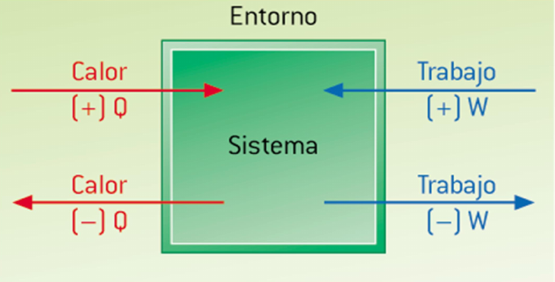
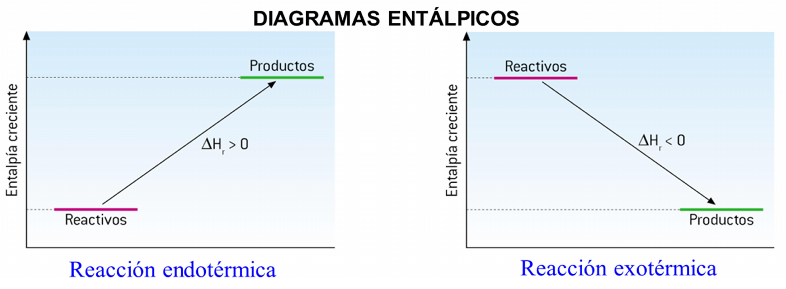
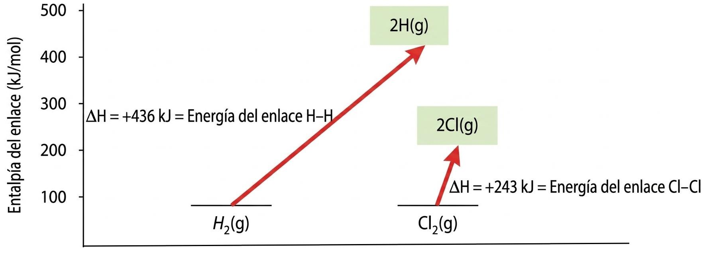
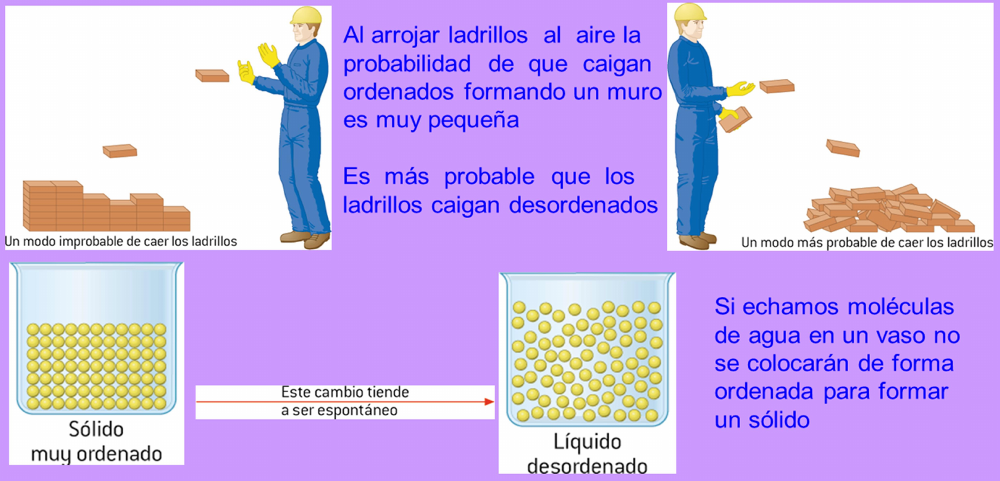
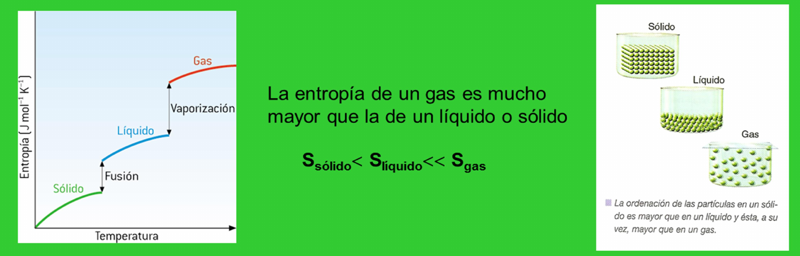
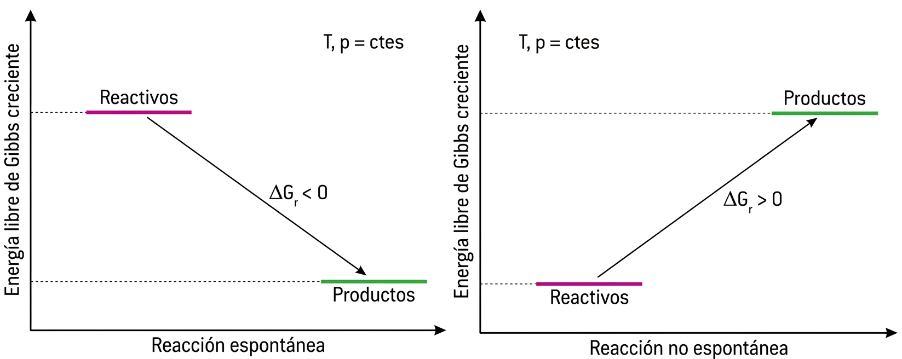
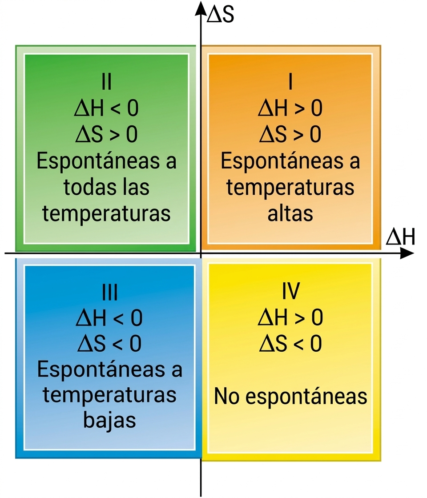

# Tema 4: Termoquímica

## **1. Introducción**.

La **termodinámica** es la ciencia que estudia las variaciones de energía que acompañan a los procesos físicos y químicos con su entorno.

La **termoquímica** es la parte de la termodinámica que se centra y estudia el intercambio de energía en las reacciones químicas.

Se distinguen dos formas de intercambio de energía entre el sistema y su entorno:

*   **Trabajo ($\ce{W}$)**
*   **Calor ($\ce{Q}$)**

$\ce{Q}$ y $\ce{W}$ se consideran positivos si entra energía en el sistema, y negativos si sale energía del sistema.

*   $\ce{Q > 0 \rightarrow}$ calor absorbido por el sistema.
*   $\ce{Q < 0 \rightarrow}$ calor desprendido por el sistema.
*   $\ce{W > 0 \rightarrow}$ trabajo realizado sobre el sistema.
*   $\ce{W < 0 \rightarrow}$ trabajo realizado por el sistema.

{ style="display: block; margin: 0 auto; width: 60%; height: auto;" }

Todas las **reacciones químicas** absorben o liberan energía, por lo general en forma de **calor**.

## **2. Primera Ley de la Termodinámica**.

La primera ley de la Termodinámica es el principio de conservación de la energía aplicado a un sistema: **la energía ni se crea ni se destruye**.

El cambio de energía interna de un sistema $\ce{\Delta U}$ es igual a la suma de la energía intercambiada como calor y como trabajo con el entorno:

$\ce{\Delta U = Q + W}$
{ style="border: 2px solid #320d71; border-radius: 12px; padding: 15px; text-align: center; width: fit-content; margin: 20px auto; display: block; background-color: #eae7ec;" }

### **El trabajo en termodinámica** {: .caja-subtitulo }

Cuando un sistema experimenta un cambio de volumen $\ce{\Delta V}$, intercambia energía mediante trabajo con su entorno. A presión constante ($\ce{p = cte}$):

$$\ce{W = -p \Delta V}$$

*   **Expansión**: $\ce{\Delta V > 0}$ y $\ce{W < 0 \rightarrow}$ Trabajo realizado por el sistema.
*   **Compresión**: $\ce{\Delta V < 0}$ y $\ce{W > 0 \rightarrow}$ Trabajo realizado sobre el sistema.

Si el volumen es constante ($\ce{V = cte}$), el trabajo es nulo ($\ce{W = 0}$) y por tanto:

$\ce{\Delta U = Q}$
{ style="border: 2px solid #320d71; border-radius: 12px; padding: 15px; text-align: center; width: fit-content; margin: 20px auto; display: block; background-color: #eae7ec;" }

En un proceso a volumen constante, la variación de energía interna se debe sólo a la energía intercambiada mediante calor con el entorno. (Nota: Los sólidos y líquidos no experimentan casi expansión, por lo que el trabajo realizado es prácticamente nulo).

## **3. Concepto de Entalpía**.

La **entalpía** es una magnitud física, con unidades de energía, que se define como:

$\ce{H = U + pV}$
{ style="border: 2px solid #320d71; border-radius: 12px; padding: 15px; text-align: center; width: fit-content; margin: 20px auto; display: block; background-color: #eae7ec;" }

### **Variación de entalpía a presión constante** {: .caja-subtitulo }

$$\ce{\Delta H = \Delta U + p\Delta V = (Q + W) + p\Delta V}$$

Sabiendo que $\ce{W = - p\Delta V}$:

$$\ce{\Delta H = Q - p\Delta V + p\Delta V = Q}$$

En un proceso a **presión constante**, la variación de entalpía del sistema es igual a la energía intercambiada mediante calor.

Utilizando la expresión $\ce{pV = nRT}$, cuando intervienen **gases** se cumple:

$$\ce{\Delta H = \Delta U + \Delta nRT}$$

## **4. Entalpía de reacción**.

La diferencia entre la entalpía de los productos de una reacción, $\ce{H_{productos}}$, y la de los reactivos, $\ce{H_{reactivos}}$, se denomina **entalpía de reacción, $\ce{\Delta H_r}$**.

$\ce{ \Delta H_r = \sum H_{productos} - \sum H_{reactivos}} $
{ style="border: 2px solid #320d71; border-radius: 12px; padding: 15px; text-align: center; width: fit-content; margin: 20px auto; display: block; background-color: #eae7ec;" }

Si $\ce{p = cte}$, el calor intercambiado con el entorno (calor de reacción) es igual a la entalpía de la reacción $\ce{\Delta H}$:

*   **Reacción endotérmica**: $\ce{\qquad Q = \Delta H_r > 0 \rightarrow H_{productos} > H_{reactivos}}$
*   **Reacción exotérmica**: $\ce{\qquad Q = \Delta H_r < 0 \rightarrow H_{productos} < H_{reactivos}}$

{ style="display: block; margin: 0 auto; width: 80%; height: auto;" }

La variación de entalpía se denomina **estándar ($\ce{\Delta H_r^\circ}$)** si la presión es de 1 atm:

$$\ce{ \Delta H_r^\circ = \sum H_{productos, \ 1 \ atm} - \sum H_{reactivos, \ 1 \ atm}} $$

**Ejemplo:** Síntesis del amoníaco $\ce{NH3}$

$$\ce{ N_2(g) + 3 H_2(g) \rightarrow 2 NH_3(g) \qquad \qquad \Delta H_r^\circ = -92,2 \, kJ}$$

La variación de entalpía estandar para esta reaccción sería:

$\ce{ \Delta H_r^\circ = 2 \cdot \Delta H_f^\circ (NH3) - 2 \cdot \Delta H_f^\circ (H2) - \Delta H_f^\circ (N2) < 0 } $

Al ser $\ce{H_{productos} < H_{reactivos}}$, $\ce{Q = \Delta H_r^\circ < 0}$, se trata de una reacción **exotérmica**.

## **5. Entalpía de formación**.

La **entalpía estándar (molar) de formación de un compuesto ($\ce{\Delta H_f^\circ}$)** es igual al cambio de entalpía de la reacción en la que se forma 1 mol de ese compuesto a la presión constante de 1 atm y una temperatura fija de 25 ºC, a partir de los elementos que lo componen en sus estados estables a esa presión y temperatura. También se denomina **calor de formación**.

**Ejemplo:** Formación de agua a partir de $\ce{O2}$ e $\ce{H2}$
$$
 H_2(g, 1 \text{ atm}, 25^\circ\text{C}) + \frac{1}{2} O_2(g, 1 \text{ atm}, 25^\circ\text{C}) \rightarrow H_2O(l, 1 \text{ atm}, 25^\circ\text{C}) 
$$
$$
 \Delta H_r = -285,8 \, \text{kJ} \Rightarrow \Delta H_f^\circ [H_2O(l)] = -285,8 \, \text{kJ} 
$$

El cambio de entalpía estándar para una reacción es igual a la suma de las entalpías estándar de formación de los productos menos la suma de las entalpías estándar de formación de los reactivos:

$$
 \Delta H_r^\circ = \sum \Delta H_f^\circ \text{ (productos)} - \sum \Delta H_f^\circ \text{ (reactivos)} 
$$

*   $\Delta H_f^\circ = 0$ para las especies elementales en su estado estable.

Para una reacción química: $aA + bB \rightarrow cC + dD$
$$
 \Delta H_r^\circ = [c \Delta H_f^\circ(C) + d \Delta H_f^\circ(D)] - [a \Delta H_f^\circ(A) + b \Delta H_f^\circ(B)] 
$$

**Ejemplo**:

Dada las entalpías estándar de formación, $\ce{\Delta H_f^\circ \ PCl3 (l) = - 317,7 kJ}$; $\ce{\Delta H_f^\circ \ PCl5 (s) = - 454,8 kJ}$, calcula el cambio de estalpía estándar $\ce{\Delta H_r^\circ }$ para la reacción: $\ce{PCl3 (l) + Cl2 (g) \rightarrow PCl5 (s) }$

**Solución**:

El $\ce{Cl2 (g)}$ es la forma estable del cloro a 1 atm por lo que $\ce{\Delta H_f^\circ Cl2 (g) = 0}$

$$\ce{\Delta H_r^\circ = \Delta H_f^\circ \ PCl5 (s) - (\Delta H_f^\circ \ PCl3 (l) + \Delta H_f^\circ \ Cl2 (g)) = -454,8 - (- 317,7 + 0) = - 137,1 kJ}$$

## **6. Reglas de la Termoquímica (Ley de Hess)**.

La **Ley de Hess** establece que la variación de entalpía de una reacción química depende únicamente de los estados inicial y final, y no del camino seguido por la reacción. Esto permite calcular entalpías de reacción sumando algebraicamente las entalpías de otras reacciones relacionadas.

## **7. Energía de enlace**.

La **energía de un enlace** químico es la entalpía, $\ce{\Delta H}$, de la reacción en la que se rompe un mol de dichos enlaces en estado gaseoso. También se denomina **entalpía de enlace**, pues $\ce{p = cte}$.

**Ejemplo:** energía de enlace de las moléculas de $\ce{H2}$ y $\ce{Cl2}$

{ style="display: block; margin: 0 auto; width: 70%; height: auto;" }

El enlace de $\ce{H2}$ es más fuerte que el de $\ce{Cl2}$

La entalpía de una reacción con gases se puede calcular a partir de las energías de enlace:

$\ce{\Delta H_r = \sum E (enlaces rotos) - \sum E (enlaces formados)} $
{ style="border: 2px solid #320d71; border-radius: 12px; padding: 15px; text-align: center; width: fit-content; margin: 20px auto; display: block; background-color: #eae7ec;" }

*   Si $\ce{\Delta H_r > 0}$: Los enlaces que hay que romper son más fuertes que los que se forman $\rightarrow$ **Reacción endotérmica**.
*   Si $\ce{\Delta H_r < 0}$: Los enlaces que hay que romper son más débiles que los que se forman $\rightarrow$ **Reacción exotérmica**.

## **8. Entropía y Segunda Ley de la Termodinámica**.

Los fenómenos en los que las cosas se desordenan son más probables que aquellos que entrañan una ordenación. El cambio espontáneo de una disposición ordenada a otra desordenada es consecuencia de las leyes de la probabilidad.

{ style="display: block; margin: 0 auto; width: 95%; height: auto;" }

*   La **entropía (S)** es una magnitud que mide el **grado de desorden** de un sistema físico o químico.
*   Es una función de estado: su variación en cualquier transformación sólo depende de los estados inicial y final.

Para una reacción química:

$\ce{\Delta S_r = \sum S_{productos} - \sum S_{reactivos} }$
{ style="border: 2px solid #320d71; border-radius: 12px; padding: 15px; text-align: center; width: fit-content; margin: 20px auto; display: block; background-color: #eae7ec;" }

*   $S^\circ$ representa la entropía estándar de una sustancia a 1 atm y 25 ºC.
*   La entropía de un gas es mucho mayor que la de un líquido o sólido: **$S_{\text{sólido}} < S_{\text{líquido}} \ll S_{\text{gas}}$**.

{ style="display: block; margin: 0 auto; width: 95%; height: auto;" }

### **Segunda Ley de la Termodinámica** {: .caja-subtitulo }

Relaciona la espontaneidad de un proceso y el aumento de desorden. En un proceso espontáneo hay un incremento neto de entropía total del universo, que comprende tanto al sistema considerado como al entorno:

$$\ce{ \Delta S_{total} = (\Delta S_{sistema} + \Delta S_{entorno}) > 0 }$$

Una **reacción es espontánea** si $\Delta S_{\text{total}} > 0$. En un proceso que se encuentra en equilibrio la entropía se mantiene constante ($\Delta S_{\text{total}} = 0$).

**Ejemplo:** Corrosión espontánea del hierro

$$\ce{ 2 Fe (s) + \dfrac{3}{2} O2 (g) + 3 H2O \rightarrow 2 Fe(OH)3(s) \qquad \Delta S_{sistema} < 0 }$$

Durante la reacción se desprende calor que pasa al entorno, el cual aumenta su entropía, de forma que $\ce{\Delta S_{total} > 0}$.

### **Tercera Ley de la Termodinámica** {: .caja-subtitulo }

La **entropía de una sustancia cristalina pura**, con ordenamiento perfecto, es **nula** en el **cero absoluto**.

## **9. Energía libre de Gibbs**.

La **energía libre de Gibbs (G)** permite evaluar la espontaneidad de un proceso sin tener en cuenta la variación de entropía del entorno. Se define como:

$$G = H - TS$$
{ style="border: 2px solid #320d71; border-radius: 12px; padding: 15px; text-align: center; width: fit-content; margin: 20px auto; display: block; background-color: #eae7ec;" }
*(donde T = temperatura absoluta, H = entalpía, S = entropía)*

Es una función de estado que sólo depende de los estados inicial y final del sistema. Cuando un sistema experimenta un cambio a temperatura y presión constantes se puede determinar la espontaneidad del proceso evaluando el cambio de G:

$$
 \Delta G_r = \Delta H_r - T \Delta S_r 
$$

Para una reacción química: $\Delta G = \sum G_{\text{productos}} - \sum G_{\text{reactivos}}$

*   Si $\Delta G_r < 0$ la reacción es **espontánea**.
*   Si $\Delta G_r > 0$ la reacción inversa es espontánea (**no espontánea**).
*   Si $\Delta G_r = 0$ el sistema está en **equilibrio**.

{ style="display: block; margin: 0 auto; width: 80%; height: auto;" }

### **Energía libre y tipos de reacciones** {: .caja-subtitulo }

Atendiendo al signo de $\Delta H$ y $\Delta S$, tenemos cuatro casos posibles:

1.  **Reacciones exotérmicas ($\Delta H < 0$) con aumento de desorden ($\Delta S > 0$)**: $\Delta G < 0$ a cualquier temperatura. **Siempre espontánea**.
2.  **Reacciones endotérmicas ($\Delta H > 0$) con aumento de desorden ($\Delta S > 0$)**: $\Delta G < 0$ solo a **temperaturas altas**. Espontánea a altas temperaturas.
3.  **Reacciones exotérmicas ($\Delta H < 0$) con aumento de orden ($\Delta S < 0$)**: $\Delta G < 0$ solo a **temperaturas bajas**. Espontánea a temperaturas bajas.
4.  **Reacciones endotérmicas ($\Delta H > 0$) con aumento de orden ($\Delta S < 0$)**: $\Delta G > 0$ siempre. **No espontánea**.

{ style="display: block; margin: 0 auto; width: 50%; height: auto;" }

**Problema resuelto:** Halla a qué temperatura es espontánea la siguiente reacción, para la cual $\Delta H^\circ = 178,2 \text{ kJ}$ y $\Delta S^\circ = 0,1610 \text{ kJ/K}$:
$$
 \text{CaCO}_3(s) \rightarrow \text{CaO}(s) + \text{CO}_2(g) 
$$
**Solución:**
El término entrópico ($-T\Delta S < 0$) favorece la espontaneidad, mientras que el entálpico ($\Delta H > 0$) la desfavorece. La temperatura a la cual ambos términos se contrarrestan es:
$$
 \Delta G^\circ = \Delta H^\circ - T\Delta S^\circ = 0 \Rightarrow T = \frac{\Delta H^\circ}{\Delta S^\circ} = \frac{178,2}{0,1610} = 1107 \text{ K} 
$$
Por tanto, a 1107 K (834 ºC) la reacción está en equilibrio. A temperaturas mayores, el término entrópico domina y $\Delta G < 0$, siendo la reacción espontánea.